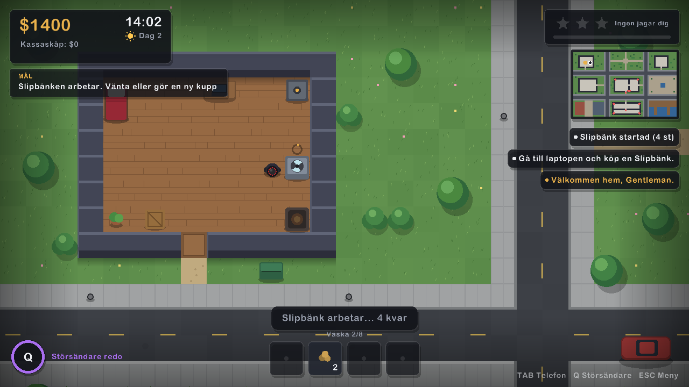
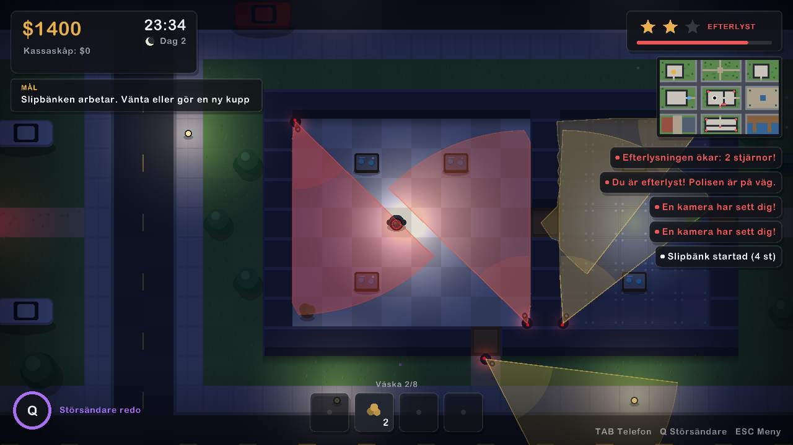
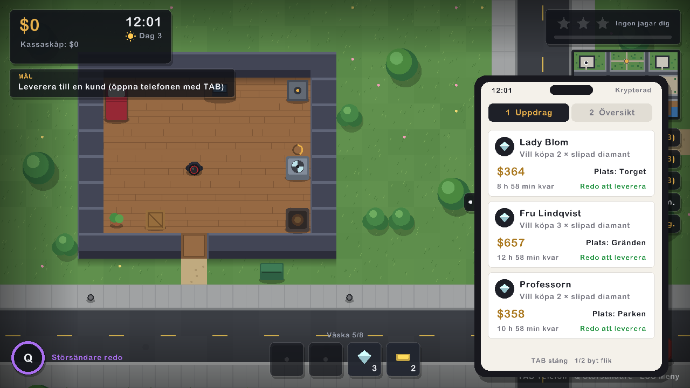
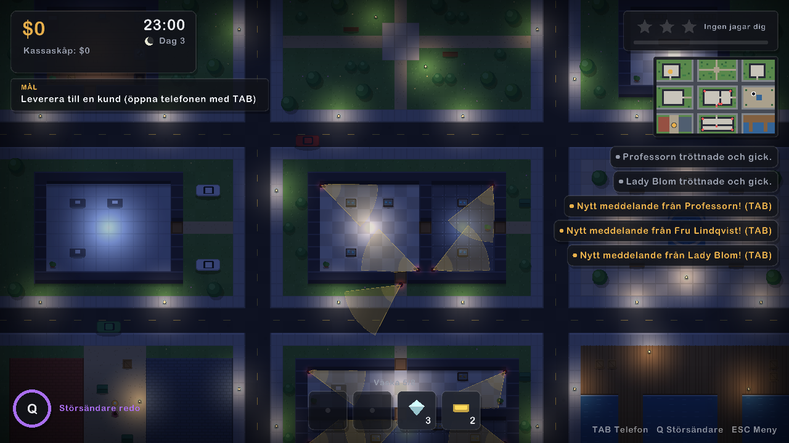

# The Gentleman 2D

Ett 2D-smygspel i C# med [Raylib](https://www.raylib.com/), där du bygger upp ett imperium i det tysta.
Du stjäl råvaror, förädlar dem i ditt gömställe och säljer till kunder som hör av sig via telefonen. Under tiden smyger du förbi kameror och skakar av dig polisen.



## Starta spelet

```bash
cd "The Gentleman 2D"
dotnet run
```

Raylib laddas ner automatiskt som NuGet-paket första gången. Spelet sparas automatiskt när du sover, blir gripen eller avslutar.

## Kontroller

| Tangent | Gör |
|---|---|
| WASD / piltangenter | Gå |
| E | Använd (håll in för att stjäla) |
| Q | Störsändare: slår ut kameror i närheten |
| TAB | Telefonen: beställningar och översikt |
| 1 / 2 | Byt flik i telefonen |
| Esc | Paus |

## Spelets loop

1. **Köp utrustning** på laptopen i gömstället. Börja med en *Slipbänk*.
2. **Stjäl** rå ädelstenar hos *Juvelerare Kronan* eller guldskrot i *Guldbanken*. Montrarna fylls på kl 06:00.
3. **Förädla** i gömstället: slipbänken gör diamanter och smältugnen gör guldtackor.
4. **Sälj** till kunderna i telefonen. Möt dem i Parken, på Torget, i Gränden eller i Hamnen innan de tröttnar.
   Råvaror kan också säljas billigt på *Pantbanken* (öppet 08–20).
5. **Bygg ut**: kassaskåp, större väska, tysta skor och till sist en störsändare.



### Kameror och efterlysning

- Kameror sveper fram och tillbaka. Konen blir röd medan de lägger märke till dig, och sedan stiger efterlysningen.
- På natten ser kamerorna kortare, utom där gatlyktorna lyser.
- **Göm dig** i buskar eller i containrar (E). Där ser kameror och polis dig inte.
- **Störsändaren** (Q) slår ut alla kameror inom 6 rutor i 20 sekunder och laddar sedan i 40 sekunder.
- 1–3 stjärnor ger lika många poliser. Håll dig undan i 6 sekunder så börjar efterlysningen sjunka.
- Blir du gripen förlorar du kontanterna och allt i väskan. Det som ligger i kassaskåpet finns kvar.

### Dag, natt och ekonomi

- Ett dygn tar 12 minuter. Natten (21–05) är mörk, och det är bäst att göra kupper då.
- Varje morgon dras $40 i hyra och marknadspriset ändras (85–125 %).
- Sängen hoppar fram till morgonen och sparar spelet.



## Kodstruktur

```
The Gentleman 2D/
├── Program.cs            Startar spelet
├── GameApp.cs            Fönster, scener (meny/spel/paus/gripen), kamera och ritning
├── GameWorld.cs          Själva spelvärlden: entiteter, system, interaktion och händelser
├── AutoPilot.cs          Automatiska tester och skärmbilder
├── Core/                 Klocka, föremål, väska, ekonomi, butik, inmatning och sparfil
├── World/                TileMap (rutnät, kollision, sikt, vägsökning) och WorldBuilder (staden)
├── Entities/             Player, PoliceOfficer, SecurityCamera, maskiner, montrar, kunder...
├── Systems/              HeatSystem (efterlysning, polis) och OrderSystem (kunder)
├── Rendering/            Mark, träd, figurer och ljus (dag/natt)
└── UI/                   Tema, HUD, minikarta, telefon, butik och menyer
```

Några OOP-idéer i koden:

- **Arv och abstrakta klasser**: allt i världen ärver från `Entity`. Maskinerna ärver från `ProductionStation`, där `GemCutter` och `Smelter` bara anger vad de tillverkar och hur de ser ut.
- **Gränssnitt**: allt man kan använda med E implementerar `IInteractable`.
- **Inkapsling**: till exempel `Inventory` håller själv koll på hur mycket som får plats.
- **Separata ansvar**: spelreglerna (`GameWorld`, `Systems/`) ritar ingenting. Därför kan `AutoPilot` testa dem utan fönster.

Inga bildfiler används. Allt ritas med former i kod.

## Tester

```bash
GENTLEMAN_AUTOPILOT=/tmp/gentleman-test dotnet run
```

Kommandot kör 22 logiktester (stjäla, tillverka, leverera, kameror, störsändare, polis, gripande, sparfil m.m.). Sedan spelas en kort sekvens upp och skärmbilder sparas i mappen. Din riktiga sparfil påverkas inte.


